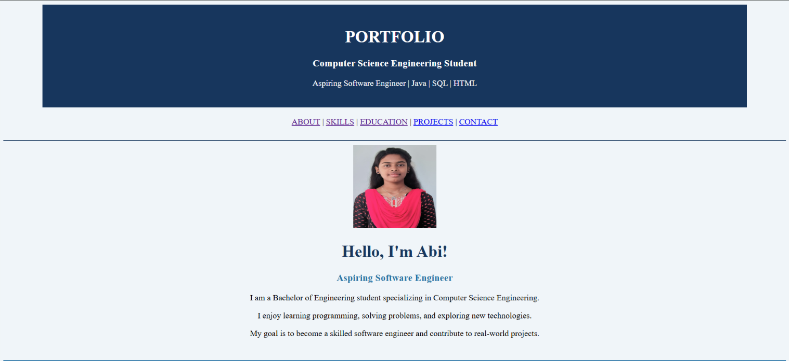

# Ex01 Portfolio
## Date: 27/10/2026

## AIM
To create a Portfolio using HTML and CSS.

## ALGORITHM
### STEP 1
Create an HTML file (index.html)

### STEP 2
Create a CSS file (style.css)

### STEP 3
Include a navigation bar with links to different sections.

### STEP 4
Add structured sections for introduction, about, projects, and contact details.

### STEP 5
Define global styles for fonts, colors, and layout.

### STEP 6
Style the header, navigation bar, and sections.

### STEP 7
Use Flexbox or CSS Grid for layout design.

### STEP 8
Add hover effects and transitions for interactivity.

### STEP 9
Add Images and Media.

### STEP 10
Use optimized images for a professional look.

### STEP 11
Open the HTML file in a browser to check layout and functionality.

### STEP 12
Fix styling issues and refine content placement.

### STEP 13
Deploy the Portfolio.

### STEP 14
Upload to GitHub Pages for free hosting.

## PROGRAM
```


<!DOCTYPE html>
<html>
<head>
    <title>Portfolio</title>
</head>

<body bgcolor="#F0F5F9">

    <center>
        <table width="90%" bgcolor="#17365D" cellpadding="20">
            <tr>
                <td align="center">
                    <h1>
                        <font color="white">
                            PORTFOLIO
                        </font>
                    </h1>

                    <h3>
                        <font color="white">
                            Computer Science Engineering Student
                        </font>
                    </h3>

                    <p>
                        <font color="white">
                            Aspiring Software Engineer | Java | SQL | HTML
                        </font>
                    </p>
                </td>
            </tr>
        </table>
    </center>

    <br>

    <center>
        <a href="#about">ABOUT</a> |
        <a href="#skills">SKILLS</a> |
        <a href="#education">EDUCATION</a> |
        <a href="#projects">PROJECTS</a> |
        <a href="#contact">CONTACT</a>
    </center>

    <br>
    <hr color="#17365D" size="2">

    <center>
        

        <h1>
            <font color="#17365D">
                Hello, I'm Abi!
            </font>
        </h1>

        <h3>
            <font color="#2874A6">
                Aspiring Software Engineer
            </font>
        </h3>

        <p>
            I am a Bachelor of Engineering student specializing
            in Computer Science Engineering.
        </p>

        <p>
            I enjoy learning programming, solving problems,
            and exploring new technologies.
        </p>

        <p>
            My goal is to become a skilled software engineer
            and contribute to real-world projects.
        </p>
    </center>

    <br>
    <hr color="#2874A6">

    <section id="about">
        <h2>
            <font color="#17365D">01. ABOUT ME</font>
        </h2>

        <p>
            I am a motivated Computer Science Engineering student
            with basic knowledge of Java, SQL, and HTML.
            I am continuously improving my technical skills
            and communication abilities.
        </p>

        <p>
            I am interested in software development and eager
            to gain practical experience through projects
            and placement opportunities.
        </p>
    </section>

    <hr color="#2874A6">

    <section id="skills">
        <h2>
            <font color="#17365D">02. TECHNICAL SKILLS</font>
        </h2>

        <table border="1" cellpadding="12" width="100%"
               bgcolor="white">
            <tr bgcolor="#D9EAF7">
                <th>Skill</th>
                <th>Area</th>
            </tr>

            <tr>
                <td>Java</td>
                <td>Programming Fundamentals</td>
            </tr>

            <tr>
                <td>SQL</td>
                <td>Database Queries</td>
            </tr>

            <tr>
                <td>HTML</td>
                <td>Web Page Development</td>
            </tr>

            
        </table>
    </section>

    <br>
    <hr color="#2874A6">

    <section id="education">
        <h2>
            <font color="#17365D">03. EDUCATION</font>
        </h2>

        <table border="1" cellpadding="12" width="100%"
               bgcolor="white">
            <tr bgcolor="#D9EAF7">
                <th>Qualification</th>
                <th>Department</th>
                <th>Year</th>
            </tr>

            <tr>
                <td>Bachelor of Engineering</td>
                <td>Computer Science Engineering</td>
                <td>2028</td>
            </tr>
        </table>
    </section>

    <br>
    <hr color="#2874A6">

    <section id="projects">
        <h2>
            <font color="#17365D">04. MY PROJECTS</font>
        </h2>

        <h3>
            <font color="#2874A6">
                Food app
            </font>
        </h3>

        <p>
            Design a user friendly food app
        </p>

        <p><b>Technologies:</b> UI&UX </p>

        <hr>

        <h3>
            <font color="#2874A6">
                Personal Portfolio Website
            </font>
        </h3>

        <p>
            Created a personal portfolio website using HTML
            to present my introduction, education, skills,
            and projects.
        </p>

        <p><b>Technology:</b> HTML</p>
    </section>

    <br>
    <hr color="#2874A6">

    <section id="contact">
        <h2>
            <font color="#17365D">05. CONTACT ME</font>
        </h2>

        <p><b>Email:</b> xxxx@gmail.com</p>

        <p><b>Location:</b> Chennai, Tamil Nadu</p>

        <p>
            <a href="mailto:xxxx@gmail.com">
                Contact Me Through Email
            </a>
        </p>
    </section>

    <br>

    <center>
        <table width="100%" bgcolor="#17365D" cellpadding="15">
            <tr>
                <td align="center">
                    <font color="white">
                        <p>Thank you for visiting my portfolio!</p>
                        <p>© 2026 Abi | Personal Portfolio</p>
                    </font>
                </td>
            </tr>
        </table>
    </center>

</body>
</html>

```


## OUTPUT




## RESULT
The program for creating Portfolio using HTML and CSS is executed successfully.
